

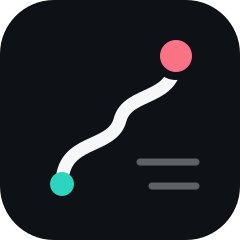

# Strava Daily Digest

**Catch up. Cheer. Move on.**

Your Strava following feed as one tidy page per day: grouped by athlete, with one-tap kudos and AI-assisted comments. An iPhone and iPad app for [Scriptable](https://scriptable.app). One file, no server, no sign-up.

  
  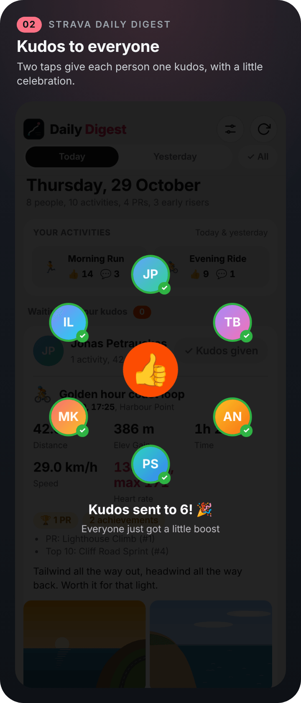
  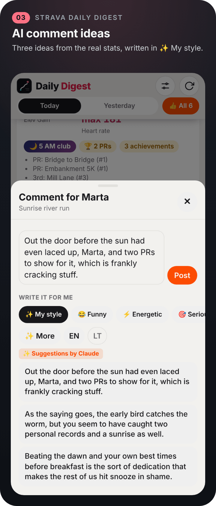

> [!NOTE]
> Screenshots are rendered from the app's real interface with invented sample data. The athletes, activities and comments are invented, the avatars are drawn initials, and the photos and route maps are drawn illustrations.

> [!IMPORTANT]
> **Unofficial.** Not affiliated with Strava, Inc. Automated access may not be permitted by Strava's terms, so use it with your own account and at your own risk. See [Disclaimer](#disclaimer).

## Highlights

- **One page per day.** Each person you follow appears once, with all of that day's activities underneath and the numbers that matter at the top: distance, pace or speed, time, elevation, heart rate, PRs, achievements and photos.
- **Waiting for kudos first.** Each day is split into people still waiting for your kudos and people you've already cheered, each with a count.
- **Kudos to everyone, in two taps.** **👍 All** sits in the pinned header. Tap it, then **Send?**, and each person in the day's digest gets one kudos, with a small celebration as Strava confirms each one.
- **One kudos per person.** When someone logs several activities, only their main one gets the kudos, so you never spam a friend's notifications. You can still give kudos to any activity on its own.
- **AI comment ideas.** 💬 opens a composer that writes comment ideas from the activity's real details, in ✨ My style or a mood (Funny, Energetic, Serious, Funky), in English or Lithuanian. Ideas also take in the activity's description, emojis included, and up to three of its photos.
- **Comments that sound like you.** Write your instructions once in Settings, and let **Learn my style** study your own past comments, so ✨ My style writes the way you do. It opens friends' activities one by one until it has the number you set, up to 50, so it can take a few minutes.
- **Early-riser badges.** The 🦉 4 AM, 🌙 5 AM and 🌅 6 AM clubs get a badge, and the day's summary counts the early risers.
- **The day's story.** Tap **📖** before **Today** and the AI writes one funny story starring everyone in the day's digest, those waiting for your kudos and those who already have it. It looks at up to three photos per person and weaves them in, with everyone's profile pictures at the top. Tap **📸 Image** to turn it into a picture for Instagram, with a QR code back to this page.
- **Photos and details in place.** Full-screen photos with swipe and zoom, and a details sheet with the route map (drawn from Strava's route line when there's no map picture), every stat, PRs, the description and photos.
- **Your activities on top.** Your latest activities sit above everyone else's. Tap one to see who gave kudos, read the comments and like them.
- **Kudos widget, launch screen, settings, updates.** A Home Screen and Lock Screen widget shows who is still waiting for your kudos; the digest opens on its logo; colours, layout and text size are in Settings; new versions are offered in the app.

## Screenshots

  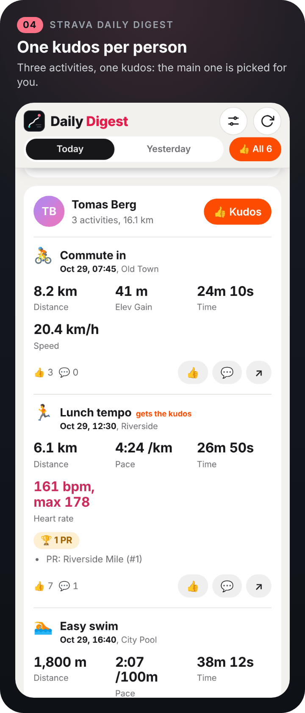
  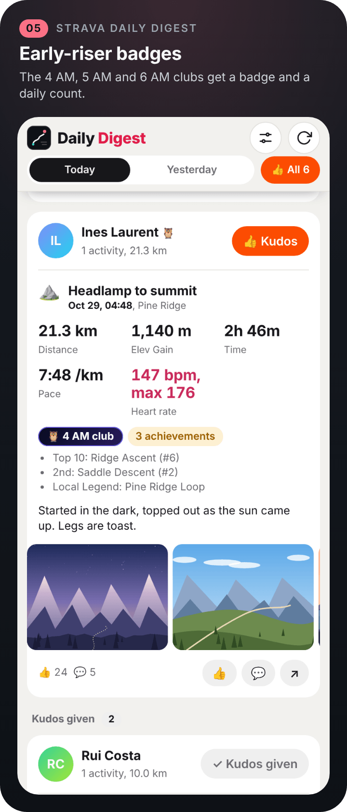
  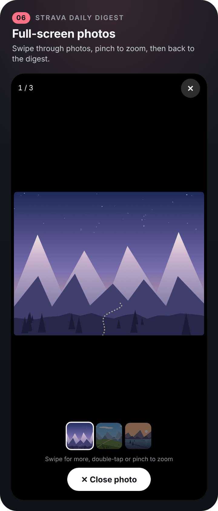

  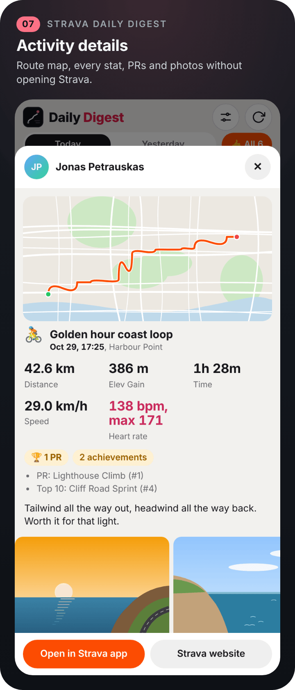
  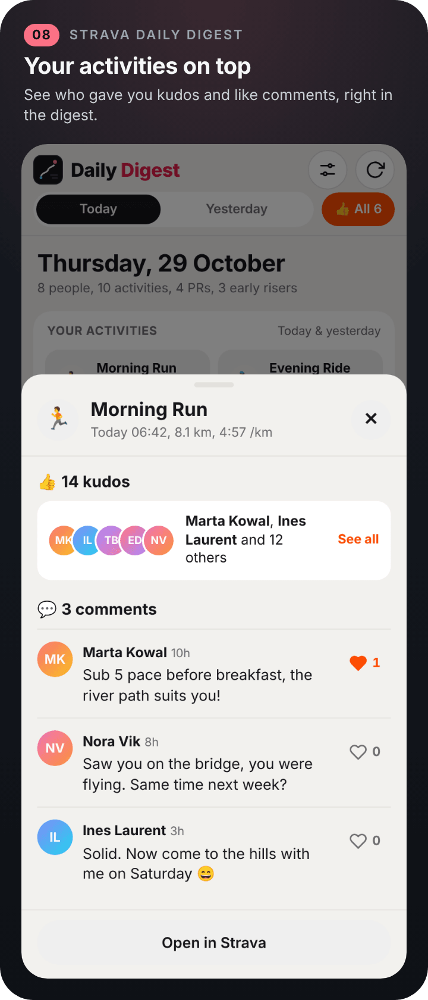
  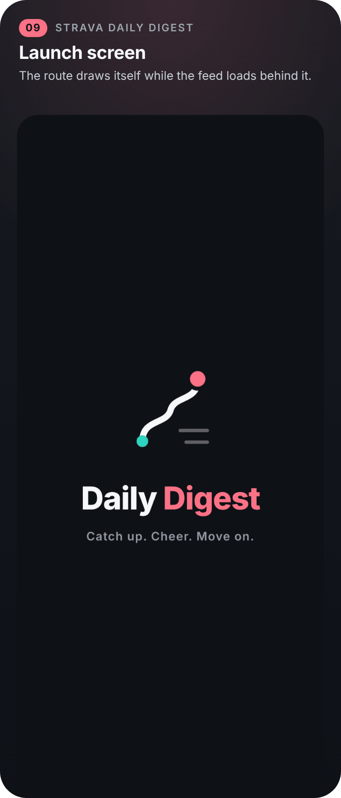

  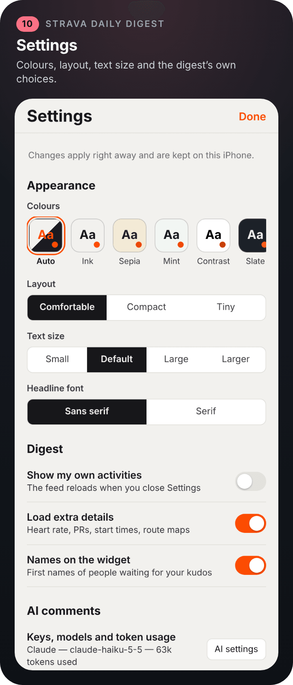
  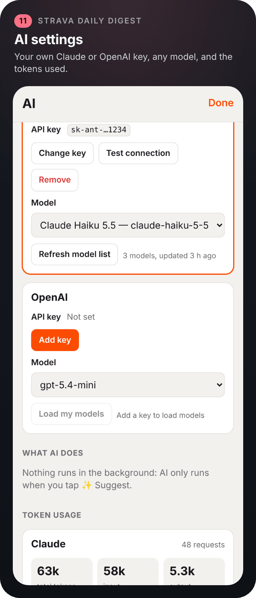
  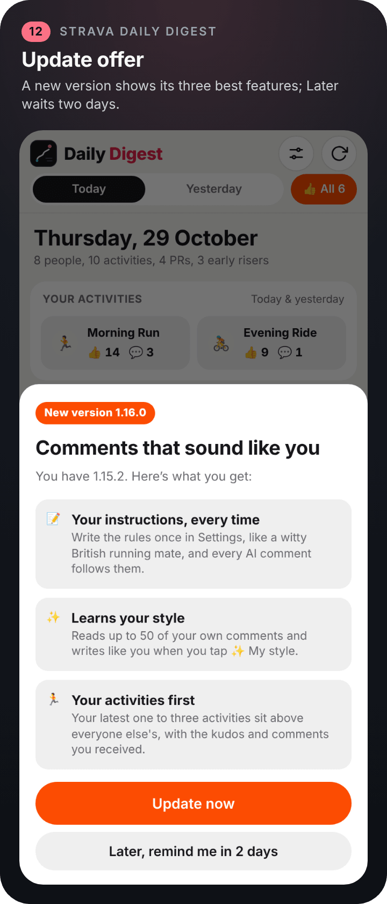

  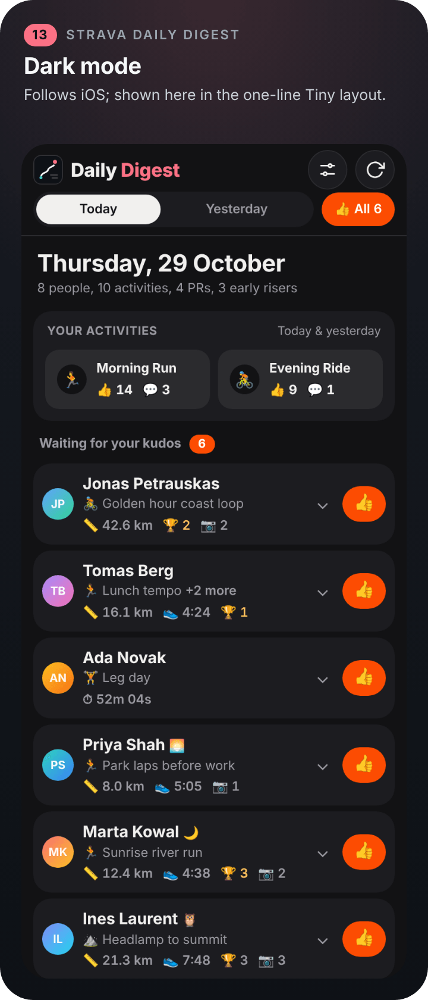
  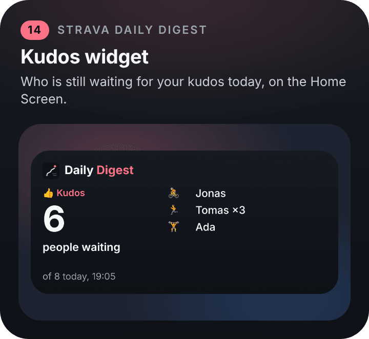
  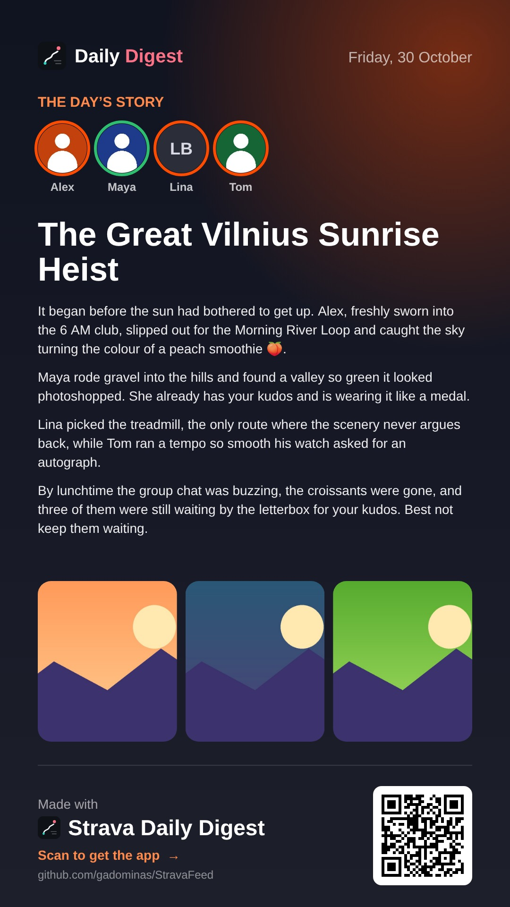

## Install

1. Get **[Scriptable](https://apps.apple.com/app/scriptable/id1405459188)** (free) on your iPhone or iPad.
2. In Scriptable, tap **+**, paste the contents of [`Install Strava Daily Digest.js`](Install%20Strava%20Daily%20Digest.js) and tap **Run** (▶). **Strava Daily Digest** now appears in your Scripts list.
3. Run **Strava Daily Digest** and log in to Strava once (see [First run](#first-run)).

To update, tap **Update now** when the digest offers a new version, or run the installer again; your settings are kept.

<b>Install by hand</b>

Either of these works:

- **Download the file:** download [`Strava Daily Digest.js`](Strava%20Daily%20Digest.js) and save it to **iCloud Drive › Scriptable**. It shows up in Scriptable automatically.
- **Copy and paste:** in Scriptable, tap **+**, paste the whole script, and name it *Strava Daily Digest*.

What you need:

- **iPhone or iPad** with the free **[Scriptable](https://apps.apple.com/app/scriptable/id1405459188)** app from the App Store.
- **A Strava account** that follows other athletes. A free account is enough; no Strava subscription is needed.
- **Optional: the Strava app**, if you want to open posts there.
- **Optional: a Claude or OpenAI API key**, for ✨ comment ideas (see [AI](#ai)).

You don't need a computer, developer account, or Strava API application.

## How to use it

### First run

1. Run **Strava Daily Digest**.
2. If you aren't logged in yet, tap **Log in to Strava** and sign in with your email and password, or with the code Strava emails you. Google and Apple sign-in usually don't work inside embedded browsers.
3. The digest opens by itself once you're logged in. Your login is remembered, so later runs go straight to your feed.

### Everyday use

| To… | Do this |
|---|---|
| Switch day | Tap **Today** or **Yesterday** in the header, which stays at the top while you scroll (Settings › Digest › Days in the header adds earlier days) |
| Give kudos to one person | Tap **👍 Kudos** on their card. Only their main activity gets it. |
| Give kudos to everyone | Tap **👍 All** in the header, then **Send?** to confirm |
| Give kudos to a specific activity | Tap 👍 on that activity |
| Comment | Tap 💬, write a comment, then tap **Post** |
| Get comment ideas | Tap 💬, pick a mood (✨ My style, 😂 Funny, ⚡ Energetic, 🎯 Serious or 🕺 Funky) and **EN** or **LT**, tap **✨ Suggest 3**, then tap an idea, edit it and **Post**. Text already in the box is used as your idea. |
| Read the day's story | Tap **📖** at the left of the day switcher; tap **🔁 Another take** for a new one, or **Share** to send it |
| See photos | Tap a photo, then swipe left or right or tap a thumbnail. Double-tap or pinch to zoom, and tap **✕ Close photo** to go back. |
| See activity details | Tap the activity title or **↗** |
| Open in Strava | In the details sheet, tap **Open in Strava app** or **Strava website** (the website opens inside the digest, with **‹ Back to digest**) |
| See your own kudos and comments | Tap one of **Your activities** at the top; tap **See all** for everyone who gave kudos, or a heart to like a comment |
| Expand a line | In the Compact and Tiny layouts, tap a line to open the full activity in place |
| Reload | Pull the page down at the top, or tap **↻** |
| Change settings | Tap the sliders icon in the header and change what you need; it applies at once. Tap **Done** to close |

<b>Why a digest</b>

Once you follow more than a handful of people, the Strava feed turns into an endless scroll. The same friend shows up three times, the posts you care about are buried between them, and giving kudos means tapping your way through every single card.

Strava Daily Digest turns that feed into **one page per day**:

- Each person appears once, with all of that day's activities underneath.
- The numbers that matter sit at the top of each activity.
- Kudos and comments are a tap away.

The bigger your feed, the more time it saves.

<b>Every feature, in detail</b>

- **👍 Kudos to everyone, in two taps.** The **👍 All** button sits in the pinned header, so it's always within reach. Tap it, then tap **Send?** to give one kudos to each person in the day's digest. A little celebration follows: thumbs fly from the centre to each athlete's photo in a circle, and a ✓ appears on each one as Strava confirms.
- **📥 Waiting for kudos first.** Each day is split into two sections: people still waiting for your kudos at the top, and people you've already given kudos to below, each with a count.
- **☝️ One kudos per person.** When someone logs several activities, only their main one gets the kudos, so you never spam a friend's notifications. The main one is picked by most PRs first, then an early start, then achievements and distance. You can still give kudos to any activity individually.
- **✨ AI comment ideas.** Comment ideas built from the activity's real details: distance, pace, heart rate, PRs, early start, title and description. Pick ✨ My style or a mood (Funny, Energetic, Serious or Funky), choose English or Lithuanian, tweak the text, then post. Settings › Comments sets how many ideas come back per tap (1 to 5, default 3).
- **💬 Comments that sound like you.** 💬 opens a composer with your draft and AI ideas. **Settings › Comment writing › Instructions for every AI comment** holds the rules every idea follows (the default is a witty British running mate), and **Learn my style** reads your own past comments so ✨ My style writes like you.
- **📅 One day at a time.** Pick Today or Yesterday from the header that stays pinned at the top while you scroll. Only the day you open is loaded.
- **👥 Grouped by athlete.** Each person gets one card holding all of their activities for that day, with totals.
- **📊 Key numbers up front.** Distance, pace or speed, time, elevation, heart rate, PRs and achievements, start date and time, and photos.
- **🌅 Early-riser badges.** Special badges for the 🦉 4 AM, 🌙 5 AM and 🌅 6 AM clubs, plus a daily count of early risers.
- **🖼 Photo viewer.** Tap a photo to view it full-screen without leaving the digest. Swipe left and right, or jump with the thumbnail strip. Double-tap or pinch to zoom, and close with the big **Close photo** button.
- **💬 Comment in place.** Write or pick a comment and post it without opening Strava. The screen locks while it's sending, with a little animation of your comment flying to your friend, and confetti when it lands.
- **🗺 Activity details.** Tap an activity's title or **↗** for a details sheet: route map, all stats, PRs, description, larger photos, kudos and comments. From there you can also open it in the Strava app or on Strava's website.
- **🏃 Your activities on top.** Your latest activities (up to three, from today and yesterday) sit above everyone else's, with the kudos and comments you received. Tap one to see who gave kudos, read the comments and like them, without opening the Strava app.
- **🔎 Peek, then expand.** In the Compact and Tiny layouts, every line shows distance, pace, trophies and photo counts. Tap to open the full activity in place.
- **⬇️ Pull to refresh.** Drag the digest down at the top to reload today's feed.
- **🏃 Fun loading screen.** While the feed loads, a runner collects posts onto a reading pile and a counter ticks up to the number of posts read.
- **⚡ Fast.** The window opens immediately and the day appears within seconds. Extra details such as heart rate and PRs fill in while you read.

## Widget

The kudos widget shows how many people are still waiting for your kudos today, under the Daily Digest logo on its dark tile. The medium size also lists up to three of them with their sport and early-riser badge; the large size lists more and adds the day's PRs and early risers. Lock Screen widgets come in inline, circular and rectangular kinds. Tapping it opens the digest. It is the shared [widgets](https://github.com/gadominas/app-blueprints/blob/main/blueprints/widgets.md) blueprint, so all the apps' widgets look alike.

1. Long-press the Home Screen, tap **Edit › Add Widget**, choose **Scriptable** and a size.
2. Long-press the widget, tap **Edit Widget**, set **Script** to *Strava Daily Digest* and **When Interacting** to *Run Script*.

Lock Screen widgets are added the same way under **Customize › Lock Screen**. Widgets can't use your Strava login, so the widget shows the summary the digest saves on this iPhone each time it loads today's feed and each time you give kudos. It never shows an error and works offline; when the summary is older than the time set in **Settings › Widget**, the bottom line turns amber and says when it was updated. **Settings › Digest › Names on the widget** turns the first names off.

To update it automatically, create a Shortcuts automation, for example at 8:00 and 18:00, with Scriptable's **Run Script** action. Choose *Strava Daily Digest*, set the parameter to `refresh`, and turn **Run In App** on.

## AI

AI is used for one thing: comment ideas. 💬 › **✨ Suggest 3** sends the activity's details to your provider and shows the ideas labelled **✨ Suggestions by Claude** (or OpenAI). **Learn my style** in Settings › Comment writing asks it once to describe how you write, from your own comments. Nothing runs in the background.

- **Your own key.** Open **Settings › AI settings**, add a [Claude](https://console.anthropic.com/settings/keys) or [OpenAI](https://platform.openai.com/api-keys) key, pick any model the key can use and tap **Test connection**. Each suggestion costs a tiny fraction of a cent.
- **Kept safe.** The key is typed into a native iOS prompt, stored in the iOS Keychain and sent only to its own provider. The app's page never sees it.
- **You see the cost.** **AI settings › Token usage** shows tokens per day, feature and model. API use is billed by the provider, separately from any chat subscription.
- **Optional.** Without a key the digest works as usual: the moods and ✨ buttons stay hidden and you write comments yourself.

## Settings

Tap the sliders icon at the top. Changes apply at once and are saved in `settings.json` in iCloud Drive › Scriptable › StravaFeed, so updates never reset them.

| Section | What you can change |
| --- | --- |
| Appearance | Colours (Auto or Ink, Sepia, Mint, Contrast, Slate, Night), layout (Comfortable, Compact, Tiny), text size (Small, Default, Large, Larger), headline font (Sans serif or Serif) |
| Digest | Show my own activities, load extra details (heart rate, PRs, start times, route maps), names on the widget |
| AI comments | AI settings (keys, models, token usage), default mood, language |
| Comment writing | Instructions for every AI comment (with Reset to default), comments read to learn your style, ✨ comment ideas per tap, Learn my style |
| Updates | Offer new versions, check now |
| Reading the feed, Digest, Widget, Account | Feed pages read for today, extra pages per earlier day, activities opened at once, time limits, days in the header, widget refresh and when it counts as out of date, your Strava athlete ID; each with Reset |
| Built with | The shared blueprints this app follows, with links (read-only) |

Two values stay in code, in the `DIGEST` block at the top of `Strava Daily Digest.js`: `DAYS_BACK` (the day shown first; you can also run the script with `?days=1`) and `DEBUG_DUMP` (saves the raw feed for troubleshooting).

## Updates and what's new

Strava Daily Digest checks this repository for a new version each time it opens. When one is out, a sheet shows its three best features with **Update now** and **Later**; Later hides the offer for two days. Your data and settings are kept. Every release is in [CHANGELOG.md](CHANGELOG.md). Tapping outside the sheet counts as Later, **Settings › Updates › Check for updates now** looks right away, and running the installer again also updates.

## Privacy and security

- **Everything runs on your phone.** There is no server in between, and nothing is collected unless you agree to share anonymous usage (below). Settings live in iCloud Drive › Scriptable › StravaFeed; the widget summary, AI settings and token usage stay in Scriptable's local storage on this iPhone.
- **Your Strava login** stays in Scriptable's private browser storage, exactly as if you had logged in to strava.com.
- **✨ Suggest** sends that one activity's details (title, stats, PRs, description, start time) and the athlete's first name, with your instructions and learned style, to the provider marked “In use”, and only when you tap it. **Learn my style** sends only your own comments. Comments you post through the digest are kept (the latest 50) in `sent-comments.json` next to `settings.json` as examples of your style.
- AI keys stay in the iOS Keychain and are only sent to their own provider.
- The update check only downloads `releases.json` from this repository.
- **Anonymous usage, only if you agree.** A one-time question (and **Settings › Privacy › Share anonymous usage**) decides whether the app sends anonymous counts to PostHog's US cloud: app opens, kudos given, comments posted, AI features used, stories made, the app version and a few display settings. Each event carries a random install ID made on your phone, not linked to Strava. Never sent: names, athlete IDs, comments, descriptions, photos or anything else from your feed. Turning it off stops sending and deletes the install ID.

## How it works

Strava's official API doesn't provide the feed of the people you follow, and it doesn't allow giving kudos or posting comments. So the digest uses your own logged-in strava.com session in a hidden browser view, making the same requests the Strava website makes when you use it. Comments are posted through Strava's own comment box on the activity page.

## Troubleshooting

| Problem | Try this |
|---|---|
| Login keeps being asked for | Log in with email and password or the emailed code, and wait until the Strava page finishes loading |
| A day shows nobody | Read the grey note under **Check again**: it shows how far the feed was read and why it stopped |
| An activity shows only a date, no time | Strava didn't share a start time; it usually appears once details finish loading |
| The Strava app says "Something went wrong" | Use the details sheet (tap the title or **↗**) instead. This is an issue in the Strava app when it's opened from a link. |
| The widget says "Open to load today" | Open the digest once today; the widget updates from it |
| "Comment not posted" | Check the activity in Strava before retrying, to avoid posting twice |
| ✨ Suggest fails or asks for a key | Open **Settings › AI settings**, tap **Test connection**, and replace the key with **Change key** if it was rejected |
| Learn my style finds too few comments | It says how many comments it read and whose name it looked for; comment a few more times, then try again |

If something breaks, open an issue with a screenshot of the error. Set `DEBUG_DUMP: true` to save the raw feed data, and attach it only after removing any names.

## Built with

- **[Scriptable](https://scriptable.app)** by Simon Støvring: one JavaScript file, a WebView for the interface.
- **[app-blueprints](https://github.com/gadominas/app-blueprints)**: the shared in-app updates, settings, AI configuration, launch screen and widgets that every one of these apps uses, so they look and behave alike. **Settings › Built with** lists the versions; [docs/BLUEPRINTS.md](docs/BLUEPRINTS.md) adds the deviations.
- **Your own Strava web feed**, read through your logged-in session (see [How it works](#how-it-works)). Header icons from [Feather](https://feathericons.com) (MIT).

Maintainers: release notes live in [`releases.json`](releases.json); see [docs/RELEASING.md](docs/RELEASING.md). Screenshots are regenerated with [repo-site](https://github.com/gadominas/app-blueprints/tree/main/repo-site) from [`docs/site/scenario.js`](docs/site/scenario.js).

## Disclaimer

- **Unofficial.** This project isn't affiliated with, endorsed by, or supported by Strava, Inc. "Strava" is a trademark of Strava, Inc.
- **It can break** when Strava changes its website. Updates will follow when that happens.
- **Intended for personal use.** Every kudos and comment is something you tap yourself; the script never acts on its own. Automated access may not be permitted by Strava's terms, so use it at your own risk.
- **Missing details.** Heart rate and other details only appear when the athlete shares them.

A personal project, provided as is, without warranty.

## More apps like this

  &nbsp;
  &nbsp;
  &nbsp;
  &nbsp;
  &nbsp;
  

Strava Daily Digest · BlogPulse · VisionX · Go2FGym · Dienynas+ · Reading Stars, all single-file Scriptable apps built on the same blueprints.

## License

[MIT](LICENSE) © 2026 Gediminas Siutilas. Issues and pull requests are welcome: keep everything in a single Scriptable file, with no build step, and test on a real device.
