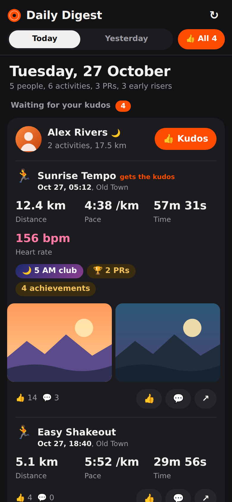
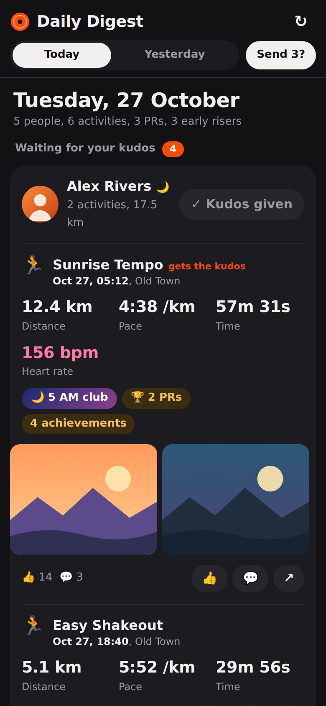
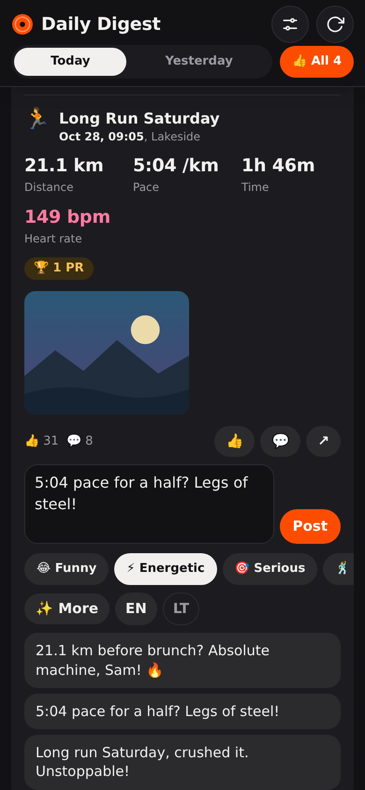
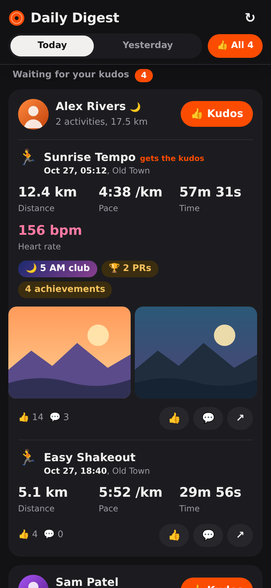
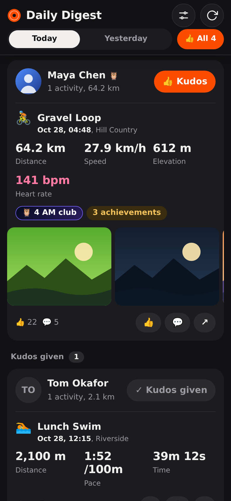
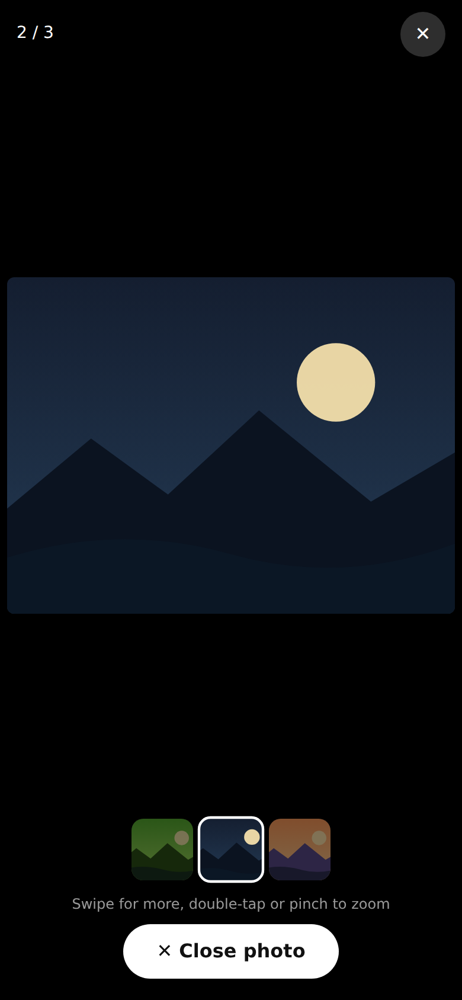
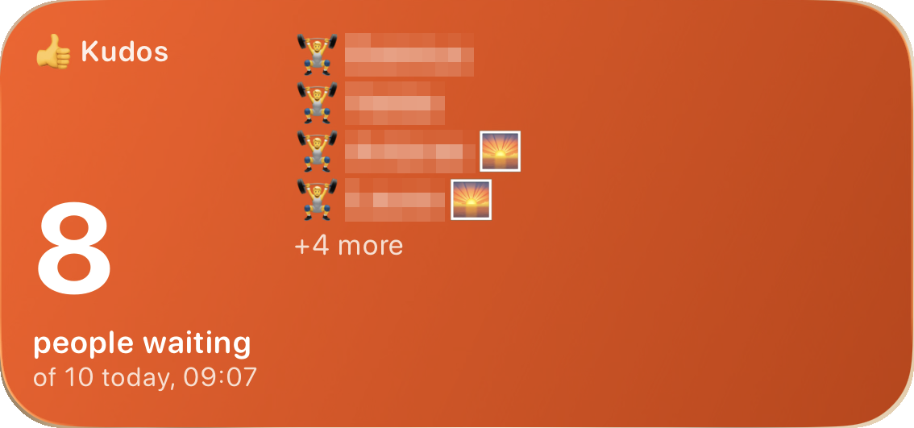

# Strava Daily Digest

**Your Strava following feed as one tidy page per day: grouped by athlete, with one-tap kudos and AI-assisted comments.**
An iPhone and iPad script for [Scriptable](https://scriptable.app).

  
  
  

> Screenshots use invented athletes and illustrative photos. In the widget screenshot, real names are pixelated.

## Why

Once you follow more than a handful of people, the Strava feed turns into an endless scroll. The same friend shows up three times, the posts you care about are buried between them, and giving kudos means tapping your way through every single card.

Strava Daily Digest turns that feed into **one page per day**:

- Each person appears once, with all of that day's activities underneath.
- The numbers that matter sit at the top of each activity.
- Kudos and comments are a tap away.

The bigger your feed, the more time it saves.

## Key features

| | |
|---|---|
| 👍 **Kudos to everyone, in two taps** | The **👍 All** button sits in the pinned header, so it's always within reach. Tap it, then tap **Send?** to give one kudos to each person in the day's digest. A little celebration follows: thumbs fly from the centre to each athlete's photo in a circle, and a ✓ appears on each one as Strava confirms. |
| 📥 **Waiting for kudos first** | Each day is split into two sections: people still waiting for your kudos at the top, and people you've already given kudos to below, each with a count. |
| ☝️ **One kudos per person** | When someone logs several activities, only their main one gets the kudos, so you never spam a friend's notifications. The main one is picked by most PRs first, then an early start, then achievements and distance. You can still give kudos to any activity individually. |
| ✨ **AI comment ideas** | Get three comment suggestions built from the activity's real stats: distance, pace, heart rate, PRs, early start, and title. Pick a mood (Funny, Energetic, Serious or Funky) or write your own prompt, choose English or Lithuanian, tweak the text, then post. |
| 📅 **One day at a time** | Pick Today or Yesterday from the header that stays pinned at the top while you scroll. Only the day you open is loaded. |
| 👥 **Grouped by athlete** | Each person gets one card holding all of their activities for that day, with totals. |
| 📊 **Key numbers up front** | Distance, pace or speed, time, elevation, heart rate, PRs and achievements, start date and time, and photos. |
| 🌅 **Early-riser badges** | Special badges for the 🦉 4 AM, 🌙 5 AM and 🌅 6 AM clubs, plus a daily count of early risers. |
| 🖼 **Photo viewer** | Tap a photo to view it full-screen without leaving the digest. Swipe left and right, or jump with the thumbnail strip. Double-tap or pinch to zoom, and close with the big **Close photo** button. |
| 💬 **Comment in place** | Write or pick a comment and post it without opening Strava. The screen locks while it's sending, with a little animation of your comment flying to your friend, and confetti when it lands. |
| 🗺 **Activity details** | Tap an activity's title or **↗** for a details sheet: route map, all stats, PRs, description, larger photos, kudos and comments. From there you can also open it in the Strava app or on Strava's website. |
| 📲 **Kudos widget** | A Home Screen and Lock Screen widget shows how many people are waiting for your kudos today, and who. |
| ⬇️ **Pull to refresh** | Drag the digest down at the top to reload today's feed. |
| 🏃 **Fun loading screen** | While the feed loads, a runner collects posts onto a reading pile and a counter ticks up to the number of posts read. |
| 🔔 **Update reminders** | When a new version is out, the digest shows its three best features and offers a one-tap update. **Later** hides the reminder for two days. |
| ⚙️ **Settings in the app** | Tap the gear in the header to change comment mood, custom prompt, language and more, without editing code. |
| 🤖 **Claude or OpenAI** | **⚙︎ › AI settings**: add a Claude or OpenAI key, pick any model your key can use, test the connection and see your token usage per day, feature and model. |
| ⚡ **Fast** | The window opens immediately and the day appears within seconds. Extra details such as heart rate and PRs fill in while you read. |

  
  
  

## Requirements

- **iPhone or iPad** with the free **[Scriptable](https://apps.apple.com/app/scriptable/id1405459188)** app from the App Store.
- **A Strava account** that follows other athletes. A free account is enough; no Strava subscription is needed.
- **Optional: the Strava app**, if you want to open posts there.
- **Optional: a Claude or OpenAI API key**, for ✨ comment suggestions. Create one at [console.anthropic.com](https://console.anthropic.com/settings/keys) or [platform.openai.com](https://platform.openai.com/api-keys). API usage is billed separately from a chat subscription, and each suggestion costs a tiny fraction of a cent. Without a key the digest works as usual and the ✨ buttons stay hidden.

You don't need a computer, developer account, or Strava API application.

## Installation

### Option A: installer (recommended, also used for updates)

1. Open **Scriptable** and tap **+** to create a new script.
2. Paste the contents of [`Install Strava Daily Digest.js`](Install%20Strava%20Daily%20Digest.js) and tap **Run** (▶).
3. **Strava Daily Digest** now appears in your Scripts list.

To update later, just run the installer again.

### Option B: manual

Either of these works:

- **Download the file:** download [`Strava Daily Digest.js`](Strava%20Daily%20Digest.js) and save it to **iCloud Drive › Scriptable**. It shows up in Scriptable automatically.
- **Copy and paste:** in Scriptable, tap **+**, paste the whole script, and name it *Strava Daily Digest*.

### Optional: kudos widget

The widget shows how many people are still waiting for your kudos today. The medium and large sizes also list their names. Tapping it opens the digest.

1. Long-press your Home Screen, tap **Edit → Add Widget**, choose **Scriptable**, and pick a size.
2. Long-press the new widget, tap **Edit Widget**, set **Script** to *Strava Daily Digest* and **When Interacting** to *Run Script*.

Lock Screen widgets are added the same way under **Customize → Lock Screen**.

Widgets can't use your Strava login, so the widget shows the summary the digest saves each time it loads today's feed and each time you give kudos. To update it automatically, create a Shortcuts automation, for example at 8:00 and 18:00, with Scriptable's **Run Script** action. Choose *Strava Daily Digest*, set the parameter to `refresh`, and turn **Run In App** on.

## First run

1. Run **Strava Daily Digest**.
2. If you aren't logged in yet, tap **Log in to Strava** and sign in with your email and password, or with the code Strava emails you. Google and Apple sign-in usually don't work inside embedded browsers.
3. The digest opens by itself once you're logged in. Your login is remembered, so later runs go straight to your feed.

## Using it

| To… | Do this |
|---|---|
| Switch day | Tap **Today** or **Yesterday** in the header, which stays at the top while you scroll |
| Give kudos to one person | Tap **👍 Kudos** on their card. Only their main activity gets it. |
| Give kudos to everyone | Tap **👍 All** in the header, then **Send?** to confirm |
| Give kudos to a specific activity | Tap 👍 on that activity |
| Comment | Tap 💬, write a comment, then tap **Post** |
| Get comment ideas | Tap 💬, pick a mood or **✎ Custom** and describe what you want, tap **✨ Suggest 3**, then tap an idea, edit it and **Post** |
| See photos | Tap a photo, then swipe left or right or tap a thumbnail. Double-tap or pinch to zoom, and tap **✕ Close photo** to go back. |
| See activity details | Tap the activity title or **↗** |
| Open in Strava | In the details sheet, tap **Open in Strava app** or **Strava website** |
| Reload | Pull the page down at the top, or tap **↻** |
| Change settings | Tap **⚙︎** in the header, change what you need, then **Save** |

## Configuration

Most settings can be changed in the app: tap **⚙︎** in the header to set the default comment mood and custom prompt, language, whether to show your own activities, extra details, names on the widget, update offers and your Strava athlete ID. They're saved in the iOS Keychain, so updates never reset them. AI keys, models and token usage have their own screen: **⚙︎ › AI settings**.

The values below are the defaults, in the `CONFIG` block at the top of `Strava Daily Digest.js`:

These settings live in the `CONFIG` block at the top of `Strava Daily Digest.js`:

| Setting | Default | What it does |
|---|---|---|
| `DAYS_BACK` | `0` | Day shown first: `0` today, `1` yesterday, and so on |
| `DAYS_IN_PICKER` | `2` | Number of days in the header: today and yesterday |
| `INCLUDE_ME` | `false` | Include your own activities |
| `ENRICH_DETAILS` | `true` | Read each activity's page for heart rate, PRs, start time and extra photos |
| `AI.LANGUAGES` | EN, LT | Languages offered in the comment box |
| `ATHLETE_ID` | `null` | Your Strava athlete ID. Only needed if it can't be detected automatically. |
| `WIDGET_NAMES` | `true` | Show first names of people waiting for kudos on medium and large widgets |
| `CHECK_UPDATES` | `true` | Offer new versions from GitHub |
| `DEBUG_DUMP` | `false` | Saves the raw feed data to Scriptable's folder for troubleshooting |

## Updates and what's new

The digest checks this repository for a newer version each time it opens. If there is one, it shows what's new and offers **Update now**. **Later**, or tapping outside, hides the reminder for two days. You can also update any time by running the installer again.

See [CHANGELOG.md](CHANGELOG.md) for every release. This app follows the shared [app blueprints](https://github.com/gadominas/app-blueprints) (see [docs/BLUEPRINTS.md](docs/BLUEPRINTS.md)). Maintainers: release notes live in [`releases.json`](releases.json); see [docs/RELEASING.md](docs/RELEASING.md).

## Privacy and security

- **Everything runs on your phone.** There is no server in between and nothing is collected. The update check only downloads `releases.json` from this repository.
- **Your Strava login** stays in Scriptable's private browser storage, exactly as if you had logged in to strava.com.
- **Your Claude or OpenAI key** is typed into a native iOS prompt, stored in the iOS Keychain and only ever sent to its own provider. The digest page only sees it masked.
- **✨ Suggest** sends that one activity's stats and the athlete's first name to the provider marked “In use”, and only when you tap it. Nothing else leaves your phone.

## How it works

Strava's official API doesn't provide the feed of the people you follow, and it doesn't allow giving kudos or posting comments. So the digest uses your own logged-in strava.com session in a hidden browser view, making the same requests the Strava website makes when you use it. Comments are posted through Strava's own comment box on the activity page.

## Limitations and disclaimer

- **Unofficial.** This project isn't affiliated with, endorsed by, or supported by Strava, Inc. "Strava" is a trademark of Strava, Inc.
- **It can break** when Strava changes its website. Updates will follow when that happens.
- **Intended for personal use.** Every kudos and comment is something you tap yourself; the script never acts on its own. Automated access may not be permitted by Strava's terms, so use it at your own risk.
- **Missing details.** Heart rate and other details only appear when the athlete shares them.

## Troubleshooting

| Problem | Try this |
|---|---|
| Login keeps being asked for | Log in with email and password or the emailed code, and wait until the Strava page finishes loading |
| A day shows nobody | Read the grey note under **Check again**: it shows how far the feed was read and why it stopped |
| An activity shows only a date, no time | Strava didn't share a start time; it usually appears once details finish loading |
| The Strava app says "Something went wrong" | Use the details sheet (tap the title or **↗**) instead. This is an issue in the Strava app when it's opened from a link. |
| The widget says "Tap to load today" | Open the digest once today; the widget updates from it |
| "Comment not posted" | Check the activity in Strava before retrying, to avoid posting twice |
| ✨ Suggest fails or asks for a key | Open **⚙︎ › AI settings**, tap **Test connection**, and replace the key with **Change key** if it was rejected |

If something breaks, open an issue with a screenshot of the error. Set `DEBUG_DUMP: true` to save the raw feed data, and attach it only after removing any names.

## Contributing

Issues and pull requests are welcome. Keep everything in a single Scriptable file, with no build step, and test on a real device.

## License

[MIT](LICENSE) © 2026 Gediminas Siutilas
